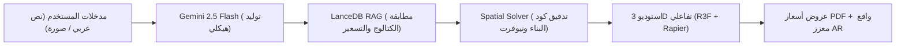
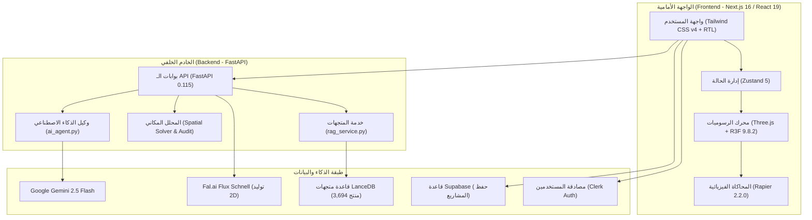

# وثيقة الملخص الشامل لمنصة رِواق — Rwaq AI

> **النسخة:** 1.0.0  
> **تاريخ التوثيق:** نوفمبر 2026  
> **طبيعة المشروع:** منصة معمارية وتصميم داخلي تفاعلية ثلاثية الأبعاد تعتمد على الذكاء الاصطناعي التوليدي، والتدقيق الهندسي الحتمي، والتسعير الحي بالريال السعودي.

---

## 1. نبذة عن المشروع والرؤية الجوهرية (Executive Summary)

**منصة رِواق (Rwaq AI)** هي استوديو معماري وتصميم داخلي سحابي تفاعلي، يعمل بالكامل داخل المتصفح وبواجهة عربية أصيلة تدعم اتجاه الكتابة من اليمين لليسار (`RTL`). 

يهدف المشروع إلى سد الفجوة بين **الخيال التصميمي** و**الواقع التنفيذي الاقتصادي والهندسي**؛ حيث يحوّل الأوصاف النصية باللغة العربية أو الصور المرجعية مباشرةً إلى غرف ومشاهد ثلاثية الأبعاد (`3D WebGL`) ذات محاكاة فيزيائية، مع تدقيق مكاني حتمي صارم وفقاً لـ **كود البناء السعودي (SBC)** ومعايير **نيوفرت (Neufert)** المعمارية، وربط كافة العناصر بكتالوج أثاث حقيقي معرّب ومفهرس بالريال السعودي (`SAR`) مع روابط شراء مباشرة.



---

## 2. المعمارية التقنية للمنظومة (System Architecture)

تعتمد المنصة معمارية هجينة تفصل بين التوليد الذكي، التدقيق الهندسي، والعرض التفاعلي الخفيف داخل المتصفح دون الحاجة إلى معالجة رسومية ثقيلة على الخادم (`Zero Server-Side Render Latency`):



### حزمة التقنيات المعتمدة (Tech Stack)

| الطبقة البرمجية | التقنيات المستخدمة | الدور الوظيفي |
| :--- | :--- | :--- |
| **الواجهة الأمامية (Frontend)** | `Next.js 16.4.6`, `React 19.3.1`, `TypeScript 5`, `Tailwind CSS v4` | واجهة مستخدم سريعة، متجاوبة، تدعم اللغة العربية `RTL` بالكامل. |
| **إدارة الحالة (State Management)** | `Zustand 5` مع دعم التخزين المحلي (`Persist`) والتراجع/الإعادة | إدارة عناصر المشهد، الميزانية، الألوان، وأنماط الإضاءة. |
| **محرك الـ 3D والفيزياء** | `Three.js 0.182`, `@react-three/fiber 9.8.2`, `@react-three/drei 10.7.7`, `@react-three/rapier 2.2.0` | تجميع المشهد داخل المتصفح، محاكاة الجاذبية والتصاق الأرضية (`t_y = 0.0`). |
| **الخادم الخلفي (Backend API)** | `FastAPI 0.115.6`, `Uvicorn 0.34.0`, `Pydantic 2.10.4` (Python 3.12) | خادم غير متزامن فائق السرعة لمعالجة الطلبات وتوجيه الذكاء الاصطناعي. |
| **الذكاء الاصطناعي التوليدي** | `Gemini 2.5 Flash` عبر مكتبة `google-genai` الرسمية | توليد المخططات المكانية الهيكلية المعقدة بنموذج `FullDesignOutput`. |
| **التوليد الصوري فائق الواقعية** | `Fal.ai Flux Schnell` | استوديو التصيير ثنائي الأبعاد عالي الجودة للقطات الداخلية. |
| **قاعدة البيانات المتجهية (RAG)** | `LanceDB 0.17.0` (متجهات 384 بعداً) | بحث دلالي فوري وتوصية بدائل الميزانية لـ 3,694 قطعة أثاث من إيكيا. |
| **المصادقة والتخزين السحابي** | `Clerk` + `Supabase PostgreSQL` | إدارة هويات المستخدمين وحفظ المشاهد المعمارية ومزامنتها. |
| **الواقع المعزز والتصدير** | `@google/model-viewer`, `jsPDF`, `html2canvas` | معاينة AR عبر الجوال وتصدير عروض أسعار وجداول كميات (BOM) رسمية. |

---

## 3. الأقسام والميزات الرئيسية في المنصة

### 1. استوديو التصميم ثلاثي الأبعاد (`/studio`)
- **البيئة والمناخ:** 3 أنماط إضاءة وطقس (`morning` صباحي مشرق، `rainy` ممطر هادئ، `midnight` ليلي دافئ).
- **إضاءة استوديو محلية (`Lightformer`):** التخلص الكامل من الاعتماد على خوادم الـ CDN الخارجية لملفات الـ HDR، مما يضمن عمل المنصة دون انقطاع.
- **نظام النوافذ الذكي (`RealRoom`):** محاكاة النوافذ على الجدار الخلفي أو الأيسر بأحجام متفاوتة مع ستائر شفافة أو حاجبة قابلة للفتح والغلق.
- **تخصيص الخامات والألوان (`MaterialPalette`):** تعديل فوري لألوان وأقمشة الجدران والأرضيات وقطع الأثاث.
- **لوحة تفاصيل المشهد وشريط الأدوات:** كشف أبعاد القطع، أسعارها، واستبدالها أو حذفها بنقرة واحدة.

### 2. التدقيق الهندسي والمكاني الحتمي (`Spatial Audit`)
محرك حسابي مدمج (`audit_spatial_layout`) لا يعتمد على تخمينات الذكاء الاصطناعي، بل يحسب الامتثال الرياضي لمعايير كود البناء السعودي ونيوفرت:
- **درجة الامتثال (`Score: 50–100`):** تقييم دقيق لجودة التوزيع الداخلي.
- **نسبة الإشغال المسموحة (`Occupancy Density`):** مراقبة المساحة المشغولة بالأثاث لتكون بين `15%` و `45%`.
- **المسافات الحركية الفاصلة (`Clearances`):** فحص المسافة بين الكنبة وطاولة القهوة (`0.30م إلى 0.65م`).
- **مسافة الرؤية للتلفاز (`TV Sightlines`):** التأكد من ابتعاد المقاعد مسافة لا تقل عن `1.5م` عن الشاشة.
- **منع التصادم ثلاثي الأبعاد (`2D/3D AABB Overlap`):** كشف أي تداخل هندسي بين الكتل يزيد عن `0.05م` (مع استثناء السجاد تلقائياً).

### 3. معرض القوالب المعمارية الجاهزة (`/maarad`)
معرض متكامل يضم 6 تصاميم نموذجية جاهزة للتحميل والتعديل المباشر بأسعارها الحقيقية بالريال السعودي:
1. **مجلس أندلسي فاخر (`majlis-andalus`):** بقيمة `13,070 SAR`.
2. **صالة معيشة جاباندي (`living-japandi`):** بقيمة `8,725 SAR`.
3. **مكتب تنفيذي مريح (`office-exec`):** بقيمة `5,050 SAR`.
4. **استوديو مودرن مبسط (`studio-minimalist`):** بقيمة `5,030 SAR`.
5. **شرفة طعام خارجية (`dining-terrace`):** بقيمة `4,495 SAR`.
6. **غرفة نوم هادئة (`bedroom-serenity`):** بقيمة `4,135 SAR`.

### 4. كتالوج الأثاث والبحث المتجهي الهجين (`/library` & RAG)
- فهرسة **3,694 قطعة أثاث فعلية** من إيكيا السعودية.
- دعم البحث الدلالي باللغتين العربية والإنجليزية مع قاموس مرادفات معماري ذكي (`أريكة`، `كنبة`، `صوفا`، `خشب زان`، `طاولة قهوة`).
- ميزة **البدائل الاقتصادية الذكية (`Smart Budget Alternatives`):** في حال تجاوزت الميزانية، يقترح النظام قطعاً بديلة بنفس الأسلوب ولكن بتكلفة أقل تلائم الفائض المالي.

### 5. استوديو التصيير ثنائي الأبعاد (`/studio2d`)
- توليد لقطات سينمائية فائقة الدقة باستخدام نموذج `Fal.ai Flux Schnell` بناءً على وصف الغرفة وخاماتها المختارة.

### 6. التصدير التجاري وجدول المواد والمعاينة بالواقع المعزز (`AR`)
- **تصدير عرض سعر رسمي (`PDF Quote`):** توليد وثيقة شراء بصيغة PDF تتضمن صور القطع، أبعادها، أسعارها بالريال، وإجمالي التكلفة.
- **جدول الكميات والمواد (`PrintReport / BOM`):** تقرير جاهز للطباعة للمقاولين ومسؤولي المشتريات.
- **معاينة الواقع المعزز (`/ar`):** فحص القطع والمجسمات في المساحة الحقيقية عبر الجوال باستخدام قارئ QR Code ونظام `@google/model-viewer`.

---

## 4. مسارات وخوادم الـ API الأساسية

| الطريقة | المسار (Endpoint) | الوظيفة والمسؤولية |
| :--- | :--- | :--- |
| `POST` | `/api/generate-room` | تحويل الوصف أو الصورة إلى مخطط 3D هندسي متكامل بأبعاد مليمترية وألوان ومود عام. |
| `POST` | `/api/v1/chat` | مساعد محادثة ذكي لتعديل عناصر المشهد وإضافة أو نقل القطع في الزمن الحقيقي. |
| `POST` | `/api/v1/spatial-audit` | إجراء التدقيق الهندسي الحتمي وإرجاع تقرير الامتثال والتوصيات المعمارية. |
| `GET` | `/api/v1/ikea-catalog` | استرجاع صفحات كتالوج الأثاث مع الأسعار وروابط المتاجر من قاعدة `LanceDB`. |
| `POST` | `/api/recommendations/alternatives` | البحث المتجهي عن بدائل أرخص متوافقة مع الميزانية المتبقية. |
| `POST` | `/api/v1/studio/generate` | توليد صور معمارية فائقة الدقة ثنائية الأبعاد عبر `Fal.ai Flux Schnell`. |
| `GET` | `/api/v1/architectural-standards` | استعراض المعايير المعمارية الرسمية المحفوظة في قاعدة المعرفة. |
| `GET` | `/api/v1/db-check` | فحص صحة قاعدة المتجهات وإحصاء عدد السجلات في كل جدول. |

---

## 5. هيكلية المجلدات البرمجية (Repository Structure)

```
rwaq-ai/
├── backend/                  # خادم الـ FastAPI والخدمات الخلفية
│   ├── app/
│   │   ├── api/routes.py     # تعريف كافة نقاط الـ Endpoints
│   │   ├── services/
│   │   │   ├── ai_service.py         # تكامل النماذج التوليدية
│   │   │   ├── rag_service.py        # بحث LanceDB والقاموس الثنائي
│   │   │   ├── spatial_solver.py     # المحلل الهندسي والتدقيق المكاني
│   │   │   └── image_gen_service.py  # توليد الصور عبر Fal.ai
│   │   ├── config.py         # إعدادات المسارات والمتغيرات
│   │   ├── main.py           # نقطة انطلاق التطبيق وإعدادات CORS
│   │   └── schemas.py        # نماذج Pydantic للتحقق من صحة البيانات
├── frontend/                 # تطبيق الواجهة الأمامية (Next.js 16 App Router)
│   ├── app/
│   │   ├── studio/           # الاستوديو ثلاثي الأبعاد الرئيسي
│   │   ├── studio2d/         # استوديو الصور التوليدية 2D
│   │   ├── maarad/           # معرض القوالب والتصاميم الستة
│   │   ├── library/          # مكتبة واستعراض كتالوج الأثاث
│   │   ├── ar/               # بوابة الواقع المعزز للجوال
│   │   └── projects/         # إدارة ومزامنة المشاريع السحابية
│   ├── components/           # المكونات المشتركة (المواد، التصدير، الهيدر)
│   ├── lib/                  # مخازن Zustand والمساعدات البرمجية
│   └── public/assets/        # مجسمات GLB ثلاثية الأبعاد المحلية عالية الدقة
├── data/                     # مجموعات بيانات الكتالوج والمعايير المعمارية
├── docs/                     # أدلة العرض التجريبي والتوثيق المكتبي
├── tests/                    # حزم اختبارات Pytest واختبارات عقود الواجهة
├── ai_agent.py               # المحرك الأساسي لتوليد المخططات ونماذج Pydantic
├── rag_ingestor.py           # سكربت فهرسة وتضمين بيانات الكتالوج في LanceDB
├── generate_pptx.py          # سكربت البناء التلقائي لعرض البوربوينت العربي
└── README.md                 # الدليل الإرشادي السريع لتشغيل المشروع
```

---

## 6. متطلبات وتشغيل النظام (Run & Deploy Guide)

### المتطلبات المسبقة:
- **Python 3.11 أو 3.12**
- **Node.js 18+** و **npm**

### خطوات التشغيل:

```powershell
# 1. إعداد بيئة البايثون وتثبيت المكتبات
python -m venv .venv
.\.venv\Scripts\activate
pip install -r requirements.txt

# 2. تجهيز ملفات البيئة
Copy-Item .env.example .env
Copy-Item frontend\.env.example frontend\.env.local

# 3. تثبيت حزم الواجهة
cd frontend
npm install
cd ..

# 4. تشغيل خادم الباك اند (FastAPI)
.\.venv\Scripts\python.exe -m uvicorn backend.app.main:app --host 127.0.0.1 --port 8000

# 5. تشغيل واجهة المستخدم (Next.js الإنتاجية)
cd frontend
npm run build
npm run start
```

- **الواجهة:** `http://localhost:3000`
- **التوثيق التفاعلي للـ API:** `http://127.0.0.1:8000/docs`
- **فحص صحة قاعدة LanceDB:** `http://127.0.0.1:8000/api/v1/db-check`

---

## 7. التحقق وضمان الجودة (Testing Suite)

```powershell
# اختبارات الخادم والتدقيق المكاني والذكاء الاصطناعي
.\.venv\Scripts\python.exe -m pytest tests/ -v

# اختبارات مطابقة العقود البرمجية للواجهة الأمامية
node --experimental-strip-types tests/verify_frontend_contracts.mjs
```

---

## 8. الخاتمة والقيمة التنافسية (Competitive Edge)

تتميز **منصة رِواق** بأنها لا تقدم مجرد "تخيل صوري جمالي" كما تفعل معظم أدوات الذكاء الاصطناعي الشائعة، بل تقدم **حلاً معمارياً هندسياً قابلاً للبناء والشراء الفوري**:
1. **حتمية هندسية:** تطبيق حقيقي لقوانين كود البناء السعودي بدلاً من التصاميم العشوائية.
2. **جدوى اقتصادية:** تسعير بالريال لكل قطعة مع روابط متاجر حقيقية وبدائل فورية للميزانية.
3. **أداء متصفح فائق:** تجربة 3D سلسلة ومحمية من انقطاعات خوادم الاستضافة أو خدمات التصيير السحابي.
