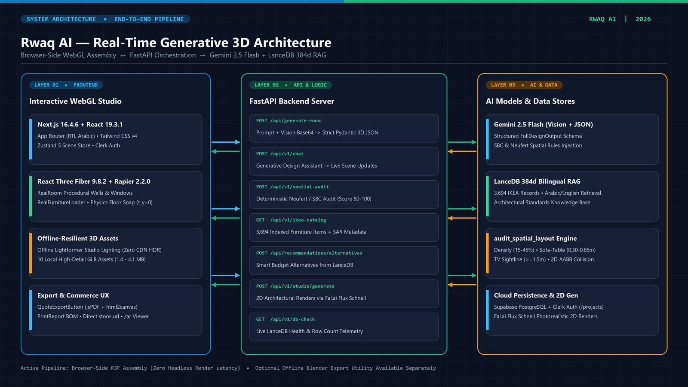

<div align="center">
  <h1>منصة رِواق — Rwaq AI</h1>
  <p><strong>منصة ذكية لتصميم المساحات الداخلية ثلاثية الأبعاد بالذكاء الاصطناعي التوليدي، والتدقيق الهندسي الحتمي، والتسعير الفوري بالريال السعودي</strong></p>
  <p>
    <code>Next.js 16.4.6</code> • <code>React 19.3.1</code> • <code>R3F 9.8.2</code> • <code>Rapier 2.2.0</code> • <code>FastAPI</code> • <code>Gemini 2.5 Flash</code> • <code>LanceDB RAG</code>
  </p>
</div>

---



## نبذة عن المشروع (Overview)

**رواق (Rwaq AI)** هو استوديو معماري وتصميم داخلي متكامل يعمل بالكامل داخل المتصفح باللغة العربية (`RTL`). يحوّل الأوصاف النصية أو الصور المرجعية مباشرةً إلى مشاهد ثلاثية الأبعاد تفاعلية مع محاكاة فيزيائية، وتدقيق مكاني حتمي وفق معايير نيوفرت وكود البناء السعودي، وتسعير حي بالريال السعودي (SAR) مرتبط بكتالوج أثاث حقيقي مفهرس في `LanceDB`.

---

## المميزات الأساسية (Core Features)

- **توليد هيكلي ثلاثي الأبعاد (`POST /api/generate-room`):** تحويل النص أو الصورة المرجعية إلى مخطط 3D منظم عبر `Gemini 2.5 Flash` (مع `FullDesignOutput` Pydantic Schema) يشمل أبعاد الغرفة، النوافذ الفعلية (`RealRoom`)، ألوان الجدران والأرضيات، ومزاج الإضاءة.
- **محادثة تصميم توليدية حية (`POST /api/v1/chat`):** تعديل المشهد وإضافة أو استبدال القطع باللغة العربية أثناء الاستعراض ثلاثي الأبعاد.
- **تجميع ثلاثي الأبعاد مقاوم للانقطاع (`WebGL / R3F 9.8.2 + Rapier 2.2.0`):** إضاءة `Lightformer` محلية بدون اعتماد على CDN خارجي، و10 مجسمات `GLB` محلية عالية الدقة (`>1 MB` لكل مجسم) مع التزام الأرضية (`t_y = 0.0`).
- **تدقيق هندسي مكاني حتمي (`POST /api/v1/spatial-audit`):** دالة `audit_spatial_layout` تمنح درجة `[50–100]` وتفحص نسبة الإشغال (`15%–45%`)، خلوص الكنبة وطاولة القهوة (`0.30–0.65م`)، مسافة الرؤية للتلفاز (`>=1.5م`)، وكشف تداخل الصناديق المحيطة (`2D AABB > 0.05م`) مع توصيات عربية فورية داخل `SpatialAuditModal`.
- **معرض قوالب جاهزة (`/maarad`):** 6 تصاميم معمارية جاهزة للتعديل بأسعارها الفعلية بالريال (`majlis-andalus` 13,070 SAR، `living-japandi` 8,725 SAR، `office-exec` 5,050 SAR، `studio-minimalist` 5,030 SAR، `dining-terrace` 4,495 SAR، `bedroom-serenity` 4,135 SAR).
- **كتالوج أثاث ببحث متجهي ثنائي اللغة (`/library` & `LanceDB`):** فهرسة 3,694 سجل أثاث من إيكيا (متجهات 384 بُعداً)، مع اقتراح بدائل الميزانية (`POST /api/recommendations/alternatives`) وروابط الشراء المباشرة (`store_url`).
- **تصدير عروض الأسعار وجدول المواد ومعاينة AR:** تصدير PDF احترافي (`QuoteExportButton` عبر `jsPDF` + `html2canvas`)، جدول مواد قابل للطباعة (`PrintReport`)، ومعاينة واقع معزز عبر رمز QR (`/ar`).
- **استوديو 2D فائق الواقعية (`/studio2d`):** توليد لقطات معمارية ثنائية الأبعاد عبر `Fal.ai Flux Schnell`.
- **مصادقة وحفظ المشاريع السحابي:** تكامل كامل مع `Clerk` للمصادقة و `Supabase` لحفظ واسترجاع المشاريع عبر `ProjectsModal`.

---

## التقنيات المستخدمة (Tech Stack)

| الطبقة | التقنيات المعتمدة |
| :--- | :--- |
| **الواجهة الأمامية (Frontend)** | `Next.js 16.4.6` (App Router), `React 19.3.1`, `TypeScript 5`, `Tailwind CSS v4`, `Zustand 5` |
| **الرسوميات والفيزياء (3D & AR)** | `Three.js 0.182`, `@react-three/fiber 9.8.2`, `@react-three/drei 10.7.7`, `@react-three/rapier 2.2.0`, `@google/model-viewer` |
| **الخادم الخلفي (Backend)** | `FastAPI 0.115.6`, `Uvicorn 0.34.0`, `Pydantic 2.10.4` (Python 3.12) |
| **الذكاء الاصطناعي والبحث المتجهي** | `Gemini 2.5 Flash` (`google-genai`), `LanceDB 0.17.0` (384-dim Bilingual RAG, 3,694 IKEA items), `Fal.ai Flux Schnell` |
| **السحابة والمصادقة والتصدير** | `Supabase`, `Clerk`, `jsPDF`, `html2canvas` |

---

## الإعداد والتشغيل من الصفر (Setup From Scratch)

### 1. استنساخ المشروع وإعداد بيئة Python (`.venv`)
```powershell
python -m venv .venv
.\.venv\Scripts\activate
pip install -r requirements.txt
```

### 2. تهيئة متغيرات البيئة (Environment Variables)
انسخ قوالب البيئة واملأ المفاتيح المطلوبة (لا ترفع ملفات `.env` أبداً إلى Git):
```powershell
Copy-Item .env.example .env
Copy-Item frontend\.env.example frontend\.env.local
```
- **في `.env` (الجذر):** `GEMINI_API_KEY`, `FAL_KEY`, `SUPABASE_URL`, `SUPABASE_ANON_KEY`, `CORS_ORIGINS=http://localhost:3000,http://127.0.0.1:3000`.
- **في `frontend/.env.local`:** `NEXT_PUBLIC_CLERK_PUBLISHABLE_KEY`, `CLERK_SECRET_KEY`, `NEXT_PUBLIC_SUPABASE_URL`, `NEXT_PUBLIC_SUPABASE_ANON_KEY`, `NEXT_PUBLIC_API_URL=http://127.0.0.1:8000`, `FAL_KEY`, و `NEXT_PUBLIC_DEMO_MODE=false` (أو `true` أثناء عرض التحكيم المحلي).

### 3. تثبيت حزم الواجهة الأمامية
```powershell
cd frontend
npm install
cd ..
```

### 4. تشغيل الخادمين (Backend + Frontend)

**أ) وضع الإنتاج المستقر (الموصى به للعرض الحي):**
```powershell
# نافذة 1 — خادم FastAPI
.\.venv\Scripts\python.exe -m uvicorn backend.app.main:app --host 127.0.0.1 --port 8000

# نافذة 2 — بناء وتشغيل Next.js
cd frontend
npm run build
npm run start
```

**ب) وضع التطوير السريع:**
```powershell
# أو تشغيل السكربت الموحد على ويندوز:
.\fix_env.bat
```
- الواجهة الأمامية: [http://localhost:3000](http://localhost:3000)
- خادم FastAPI: [http://127.0.0.1:8000](http://127.0.0.1:8000)
- فحص صحة قاعدة المتجهات: [http://127.0.0.1:8000/api/v1/db-check](http://127.0.0.1:8000/api/v1/db-check)

---

## تشغيل الاختبارات والتحقق (Testing & Verification)

```powershell
# اختبارات الخادم والذكاء والتدقيق المكاني (pytest)
.\.venv\Scripts\python.exe -m pytest tests/ -v

# اختبارات عقود الواجهة الأمامية
node --experimental-strip-types tests/verify_frontend_contracts.mjs
```

---

## الوثائق وملفات العرض التقديمي

- **دليل العرض الحي للجنة التحكيم (4 دقائق):** [docs/DEMO_RUNBOOK.md](docs/DEMO_RUNBOOK.md)
- **توثيق المعمارية وسير العمل:** [project_workflow.md](project_workflow.md)
- **العرض التقديمي (PowerPoint RTL):** [Rwaq_AI_Competition_Presentation.pptx](Rwaq_AI_Competition_Presentation.pptx) (يُنشأ عبر `.\.venv\Scripts\python.exe generate_pptx.py`)
- **العرض التقديمي (HTML / PDF Print):** [rwaq_presentation_deck.html](rwaq_presentation_deck.html)
